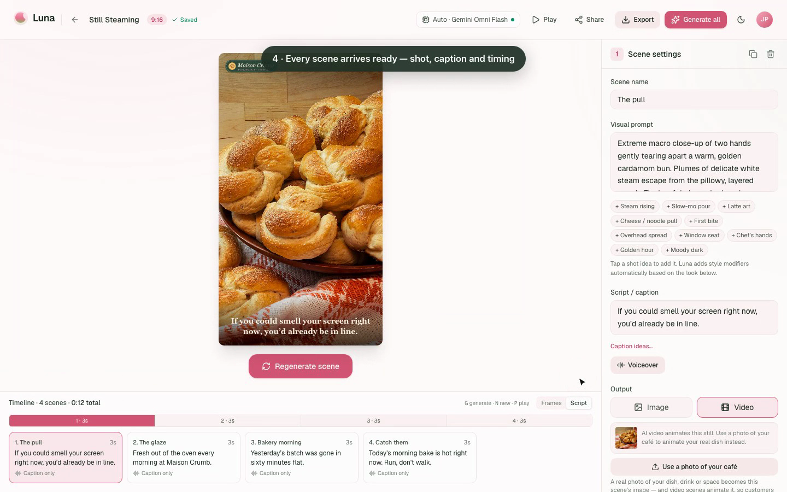

# 🌙 Luna

**Turn a simple idea and your own café photos into a short AI commercial.**

Luna is a storyboard-first tool for local cafés. Describe what you want to
promote in a sentence, choose one of three drafted concepts, and Luna builds a
shot-by-shot storyboard that you can review, regenerate and export as a branded
vertical video, with a ready-to-post caption. You don't need to write prompts,
edit video or know anything about AI models.

Luna was built as the high-fidelity prototype for **DH2655 Cooperative
IT-design at KTH Royal Institute of Technology (autumn 2026)** by Group Luna:
Alicia Nordström, Yihuan Ma, Weining Yan and Janhvi Patil. The design comes
from market research, a competitor analysis, expert interviews and user testing
with peers and three Stockholm cafés.

- 🎬 **Demo video:** [`docs/luna-demo.mp4`](docs/luna-demo.mp4), a narrated
  2.5-minute walkthrough
- 🌐 **Live prototype:** <https://luna-henna-theta.vercel.app>



---

## Features

Each feature traces back to something we heard in research or testing.

- **About your café & brand look.** Venue name, signature item,
  neighbourhood and vibe, plus logo, colours and caption font. Set them once and
  Luna reuses them in every commercial, including the branded end card.
- **Café templates.** 30 starter storyboards in five categories (menu & dishes,
  offers & promos, behind the scenes, events & seasons, social & reviews), with
  your café's details filled in automatically.
- **Draft with AI: three options.** Describe the ad in one or two sentences
  and Luna drafts three distinct concepts to choose from. (A café owner asked
  for "just three ads to choose from".)
- **Storyboard editor.** A timeline showing each scene's length and the total,
  drag-to-reorder, and a Script view with every scene's exact caption and
  voiceover. Each scene can be generated and regenerated on its own, and
  earlier takes are kept.
- **Use a photo of your café.** Animate your own photos into video clips so
  the ad shows your real food and space. There's also a *Cartoon* look for
  playful ads that don't try to look real.
- **Voiceover & music.** Text-to-speech per scene (scene length adapts to the
  narration) plus a background track.
- **Export.** Server-side FFmpeg render to MP4 in 9:16, 4:5, 1:1 or 16:9, an
  AI-written *Caption for your post*, and extra downloads under "More
  downloads".
- **Idea bank.** Type or dictate ad ideas whenever they come up. AI groups
  them into themes, and any idea can become a storyboard in one click.
- **Accounts, sharing & privacy.** Supabase auth, per-user storage with
  row-level security, and public share links. Each café brings its own Gemini
  key, which is encrypted at rest (AES-256-GCM).

---

## Getting started

Luna targets **Node ≥ 20.9** (Next.js 16 requirement). An `.nvmrc` is included:

```bash
nvm use          # picks up Node 22 from .nvmrc
npm install
cp .env.example .env.local   # then fill in the Supabase values below
npm run dev                  # http://localhost:3000
```

Generation runs immediately on the built-in **Luna Preview** provider (styled
placeholder frames, no keys), so you can design flow and copy before wiring a
real model.

### Auth & database (Supabase)

Luna uses Supabase for authentication and per-user storyboard storage. Set:

```bash
NEXT_PUBLIC_SUPABASE_URL=https://<project-ref>.supabase.co
NEXT_PUBLIC_SUPABASE_ANON_KEY=sb_publishable_...
```

The schema (`profiles`, `storyboards`) and its row-level-security policies live
in `supabase/migrations`. Auth is email/password; sessions are refreshed in
`src/proxy.ts` (Next.js 16's renamed middleware) and every route except the auth
screens requires a session.

> **Email confirmation:** by default Supabase requires new users to confirm
> their email before they can sign in. For frictionless local testing you can
> turn this off at **Authentication → Providers → Email → "Confirm email"** in
> the Supabase dashboard. For production with confirmation on, add your deployed
> URL under **Authentication → URL Configuration → Redirect URLs**.

### Production build

```bash
npm run build    # uses the webpack builder (see note below)
npm start
```

> **Note on the build.** `npm run build` uses `next build --webpack`. In this
> repo's environment, Turbopack's production-build worker fails to resolve
> Tailwind v4's native `@tailwindcss/oxide` binary from its bundle sandbox,
> while both the webpack build and Turbopack **dev** (`npm run dev`) work
> perfectly. `npm run build:turbopack` is kept so you can retry the Turbopack
> build as that issue is resolved upstream.

---

## Connecting a real backend

Luna ships with these providers (see [`src/lib/providers`](src/lib/providers)):

| Provider                | Kind                                        | Configure with                                   |
| ----------------------- | ------------------------------------------- | ------------------------------------------------ |
| **Gemini Omni Flash**   | Video (default; photo-to-video)             | User's own Gemini key (Profile → Gemini)         |
| **Google Veo 3.1 Fast** | Video (text/image-to-video, native audio)   | User's own Gemini key                            |
| **Gemini images**       | Images (Nano Banana)                        | User's own Gemini key                            |
| **Luna Preview**        | Built-in: matched stock food photos         | _nothing (always on)_                            |
| **Replicate**           | Hosted open models                          | `REPLICATE_API_TOKEN`                            |
| **ComfyUI**             | Self-hosted node-graph engine               | `COMFYUI_URL` (+ a workflow)                     |

Gemini keys are stored per user, encrypted with `APP_ENCRYPTION_KEY`
(see `.env.example`).

1. Copy `.env.example` to `.env.local` and fill in the keys for the backend you
   want.
2. Restart the dev server.
3. Open the **backend chip** in the app header and select your provider — it
   shows "Connected" once its config is detected.

### Adding your own provider

A provider is a thin adapter — implement the `Provider` interface and register
it. Nothing else in the app needs to change:

```ts
// src/lib/providers/types.ts
export interface Provider {
  id: string;
  name: string;
  description: string;
  capabilities: { image: boolean; video: boolean };
  isConfigured(): boolean;
  generate(req: GenerationRequest): Promise<GenerationResult>;
}
```

Add it to the registry in [`src/lib/providers/index.ts`](src/lib/providers/index.ts).
`buildStyledPrompt()` in `providers/prompt.ts` gives you consistent, style-aware
prompts across every backend.

---

## Architecture

```
src/
  app/
    (app)/                   Dashboard, storyboard editor, idea bank, profile
    (auth)/                  Login & sign-up
    (marketing)/             Welcome, pricing, privacy, terms
    api/draft                AI storyboard drafting (three options)
    api/generate             Generation endpoint → provider layer (+ jobs)
    api/narrate, api/caption Voiceover (TTS) and post captions
    api/render               Server-side FFmpeg export
    api/ideas/organize       Idea bank → themes
    share/[id]               Public share page
  components/                Dashboard, editor, ideas, profile, providers, ui
  lib/
    providers/               Pluggable generation backends
    draft/, narrate/         Gemini / Claude drafting and TTS
    templates.ts, venue.ts   Café templates filled from the venue profile
    store.ts, data/          Zustand store synced to Supabase
supabase/migrations/         Schema + row-level-security policies
scripts/demo/                Playwright script that recorded the demo video
```

**Data flow:** the client store holds storyboards and syncs them to Supabase. A
generate action calls `/api/generate`, which resolves the right provider on the
server (your choice, then a configured one, then the always-available
preview). Long video jobs are tracked in a `generation_jobs` table so they
survive reloads, and the finished asset is written back onto the scene.

---

## Course report

The project report (process, research, user evaluation and discussion)
describes how each design decision was motivated. Luna is a course prototype:
billing is not wired up, and the high-fidelity version has not yet been
evaluated with cafés.

## Roadmap

- Hosted generation so cafés don't need their own API key.
- Test the high-fidelity prototype with more cafés, and compare realistic and
  cartoon looks.
- Direct publishing to Instagram and TikTok, and analytics-based suggestions
  for posting time, length and music.
- Expand to bakeries, restaurants and salons, with seasonal campaigns and ads
  in any language.
